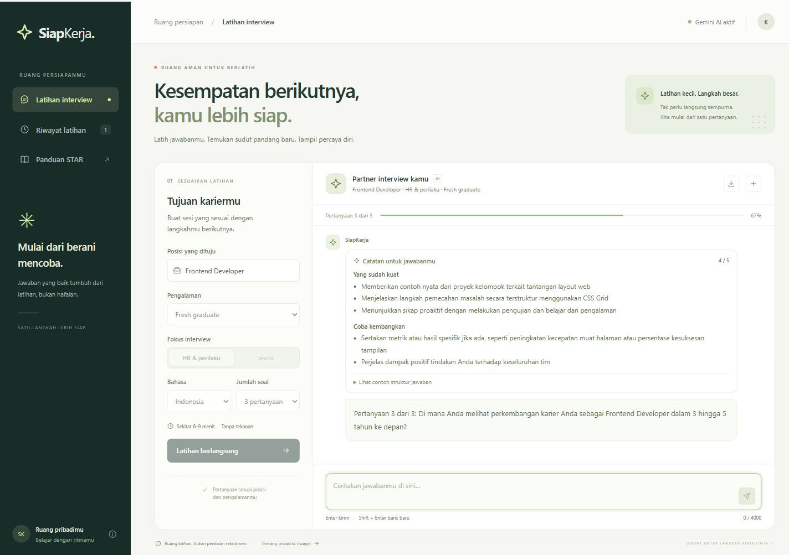

# SiapKerja

SiapKerja adalah chatbot latihan interview untuk mahasiswa, fresh graduate, dan pencari kerja. Pengguna memilih posisi, tingkat pengalaman, jenis interview, dan bahasa, lalu berlatih menjawab satu pertanyaan pada satu waktu. Chatbot memberi umpan balik dan rangkuman hal yang bisa diperbaiki.

Project ini menggunakan Gemini API melalui backend Node.js dan Express, dengan HTML, CSS, dan Vanilla JavaScript di frontend.




## Fitur

- Simulasi interview HR atau teknis untuk posisi yang ditulis pengguna.
- Pilihan pengalaman fresh graduate, junior, atau mid-level; bahasa Indonesia atau Inggris; dan 3, 5, atau 7 pertanyaan.
- Pertanyaan bertahap dengan konteks jawaban sebelumnya.
- Umpan balik tentang struktur, relevansi, dan kejelasan jawaban, disertai saran perbaikan.
- Laporan akhir, panduan STAR, dan ekspor transkrip ke file TXT.
- Riwayat sesi di browser yang dapat dibuka kembali atau dihapus.
- Mode demo untuk mencoba alur aplikasi tanpa API key.

Mode demo memakai contoh pertanyaan dan respons. Umpan balik demo hanya ilustrasi, bukan penilaian AI terhadap jawaban pengguna. Aplikasi otomatis menggunakan mode demo saat `GEMINI_API_KEY` belum diisi dan mode Gemini saat key tersedia. Hasil latihan membantu persiapan dan tidak menjamin kelulusan rekrutmen.

## Menjalankan di komputer sendiri

Siapkan Node.js versi 22 atau lebih baru dan npm. Buka terminal di folder project ini, lalu jalankan:

```powershell
npm install
Copy-Item .env.example .env
```

Perintah `Copy-Item` cukup dijalankan saat pertama kali membuat `.env`. Jika file tersebut sudah ada, edit isinya agar konfigurasi sebelumnya tetap tersimpan.

Untuk menggunakan Gemini, ambil API key dari [Google AI Studio](https://aistudio.google.com/api-keys), kemudian isi `.env`:

```dotenv
GEMINI_API_KEY=isi_api_key_anda
GEMINI_MODEL=gemini-3.5-flash-lite
```

Default project ini adalah [Gemini 3.5 Flash-Lite](https://ai.google.dev/gemini-api/docs/models/gemini-3.5-flash-lite). Materi kelas mencontohkan Gemini 2.5 Flash; nama model dapat diganti melalui `GEMINI_MODEL` sesuai model yang tersedia pada akun Anda. API key hanya dibaca backend dan tidak perlu ditulis dalam file frontend.

Jalankan server:

```powershell
npm start
```

Buka [http://127.0.0.1:3000](http://127.0.0.1:3000). Server berjalan pada alamat loopback komputer Anda. Tekan `Ctrl+C` di terminal untuk menghentikan server. Mode aktif ditampilkan pada aplikasi. Untuk mencoba demo, kosongkan nilai `GEMINI_API_KEY` pada `.env`, lalu jalankan ulang server.

## Mencoba latihan

1. Isi posisi, misalnya `Frontend Developer`.
2. Pilih tingkat pengalaman, interview HR atau teknis, bahasa, serta jumlah pertanyaan.
3. Mulai sesi dan jawab pertanyaan yang muncul. Berikan pengalaman nyata atau contoh proyek agar umpan balik lebih berguna.
4. Baca umpan balik, lalu lanjutkan ke pertanyaan berikutnya.
5. Setelah sesi selesai, baca rangkuman dan unduh transkrip bila diperlukan.

Panduan STAR membantu menyusun jawaban: **Situation** menjelaskan situasi, **Task** menjelaskan tanggung jawab, **Action** menjelaskan tindakan Anda, dan **Result** menjelaskan hasilnya.

## Cara kerja

```text
Browser (HTML, CSS, JavaScript)
        |
        | POST /api/chat
        v
Backend Express -> validasi input dan konteks sesi
        |
        v
Gemini API -> pertanyaan, umpan balik, atau laporan
        |
        v
Backend -> respons JSON -> tampilan chat
```

`systemInstruction` menetapkan peran chatbot sebagai pelatih interview, bahasa yang digunakan, batasan topik, dan format respons. Konfigurasi model menggunakan `temperature: 0.7` dan `topP: 0.9`. Riwayat percakapan sesi dikirim sebagai konteks agar pertanyaan lanjutan berhubungan dengan jawaban sebelumnya.

Mode demo menggunakan respons contoh lokal melalui alur aplikasi yang sama. Mode Gemini mengirim isi percakapan ke layanan Gemini untuk menghasilkan respons.

```text
.
|-- index.js             # Server, aset statis, dan endpoint API
|-- lib/                 # Logika interview, validasi, dan integrasi AI
|-- public/
|   |-- index.html       # Antarmuka aplikasi
|   |-- style.css        # Tampilan desktop dan ponsel
|   `-- script.js        # Interaksi, request API, dan riwayat browser
|-- docs/
|   `-- PENGUMPULAN.md   # Jawaban form dan panduan pengumpulan
|-- .env.example         # Contoh konfigurasi tanpa kredensial
|-- .gitignore
`-- package.json
```

Endpoint utama:

| Endpoint | Kegunaan |
| --- | --- |
| `GET /api/health` | Memeriksa apakah backend berjalan dan konfigurasi AI tersedia. |
| `POST /api/chat` | Memulai interview (`start`), memproses jawaban (`answer`), atau menyusun laporan (`summary`). |

Request chat membawa `action`, `settings`, `conversation`, dan `questionIndex`. `settings` berisi `role`, `level` (`fresh`, `junior`, `mid`), `type` (`hr`, `technical`), `language` (`id`, `en`), dan `totalQuestions` (`3`, `5`, `7`). Riwayat `conversation` menggunakan objek `{ role: "user" | "model", text: "..." }`. Respons membawa `mode`, `reply`, `feedback`, dan `summary`; dua nilai terakhir dapat bernilai `null` sesuai tahap interview.

## Riwayat dan API key

Riwayat disimpan dengan `localStorage` di browser yang digunakan, tanpa akun atau database. Riwayat tidak otomatis muncul di perangkat lain dan dapat hilang jika data browser dibersihkan. Gunakan tombol hapus riwayat untuk menghapus data latihan pada browser tersebut. File TXT yang sudah diunduh perlu dihapus secara terpisah bila tidak diperlukan.

Saat mode Gemini digunakan, percakapan diproses oleh Gemini API. Gunakan contoh pengalaman yang cukup untuk latihan tanpa menyertakan data rahasia perusahaan atau kredensial.

`.env` dan `node_modules/` dikecualikan oleh `.gitignore`. Jangan menaruh API key dalam screenshot, transkrip, README, atau commit Git. `.env.example` berisi nama konfigurasi dan dapat dipublikasikan tanpa API key asli.

## Memeriksa project

```powershell
npm run check
npm test
```

Pemeriksaan otomatis membantu memeriksa sintaks dan perilaku backend. Untuk memastikan koneksi Gemini pada akun Anda, jalankan satu sesi dengan API key yang valid dan periksa respons di aplikasi.

Hasil pemeriksaan project tercatat di [catatan validasi](docs/VALIDASI.md).

Tampilan ponsel tersedia pada [screenshot mobile](docs/screenshots/siapkerja-mobile.jpg).

## Jika mengalami kendala

| Kendala | Langkah yang bisa dicoba |
| --- | --- |
| `npm` tidak dikenali | Pasang Node.js, lalu buka ulang terminal. |
| Halaman tidak terbuka | Pastikan `npm start` masih berjalan dan buka alamat yang ditampilkan terminal. |
| Gemini belum tersedia | Isi `GEMINI_API_KEY` pada `.env`, simpan, lalu jalankan ulang server. |
| API key atau model ditolak | Periksa key dan akses model pada akun Google AI Studio, lalu sesuaikan `GEMINI_MODEL`. |
| Batas penggunaan API tercapai | Tunggu sampai kuota tersedia atau gunakan mode demo untuk mencoba antarmuka. |

